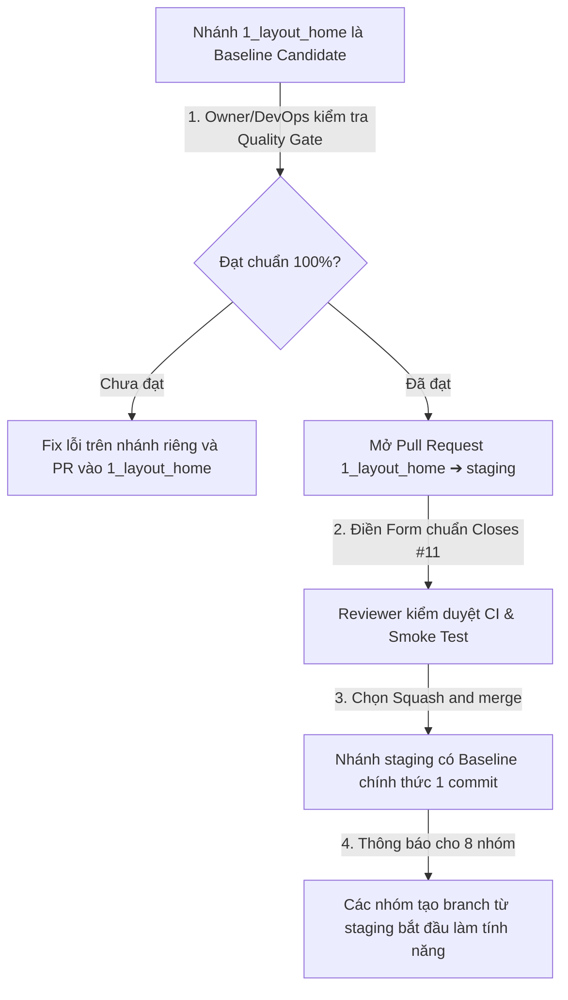

# 🛡️ BỘ TIÊU CHUẨN QUALITY GATE & ĐIỀU KIỆN ĐƯA BASELINE LÊN STAGING (ISSUE #11)

> **Dự án:** Quản lý Văn bản và Tài liệu Bảo Long (QLVB & TLBM)  
> **Nhóm thực hiện:** Nhóm 1 (Kiến trúc App Shell, Xác thực & Dashboard)  
> **Đơn vị kiểm duyệt:** DevOps Lead (Lê Thanh Hậu & Đỗ Mạnh Quang)  
> **Nhánh áp dụng:** Đưa mã nguồn từ nhánh các nhóm (đặc biệt `1_layout_home`) lên nhánh tích hợp chung **`staging`**  

---

## 🎯 1. Mục Đích & Nguyên Tắc Cốt Lõi

> [!IMPORTANT]
> **Trạng thái Baseline:** Mã nguồn trên nhánh `1_layout_home` hiện tại là **Baseline Candidate (Bản chuẩn tạm thời / ứng viên)**, chưa phải baseline chính thức của `staging`.  
> Việc cập nhật và đồng bộ tài liệu là điều kiện tiên quyết để 8 nhóm bắt đầu đọc và code theo cùng một chuẩn mực. Tuy nhiên, việc đồng bộ tài liệu **chưa đồng nghĩa với việc Issue #11 đã hoàn tất hoặc staging đã sẵn sàng**; CI (kiểm tra tự động), cấu hình môi trường và smoke test (kiểm thử nhanh luồng chính) vẫn là các phần việc kiểm định độc lập tiếp theo.

Để đảm bảo nhánh **`staging`** luôn ở trạng thái ổn định tuyệt đối (Production-ready), làm mốc chuẩn (Baseline) cho cả 8 nhóm trong lớp **tạo branch từ `staging` để phát triển tính năng**, mọi Pull Request đưa vào `staging` bắt buộc phải vượt qua **100% Tiêu chuẩn Quality Gate 5 Lớp**.

---

## 🧪 2. Chi Tiết 5 Lệnh Kiểm Tra Bắt Buộc (Quality Gate Verification Gates)

Mỗi lần kiểm tra trước khi đưa lên `staging`, toàn bộ 5 lệnh sau đây bắt buộc phải chạy và trả về kết quả **PASS (Màu xanh 100%)**:

```bash
# -------------------------------------------------------------------
# LỚP 1 & 2: KIỂM SOÁT BACKEND DJANGO
# -------------------------------------------------------------------
cd backend

# Lệnh 1: Kiểm thử toàn diện logic xác thực và bảo mật tài khoản
python manage.py test accounts
# Yêu cầu: PASS 100% (Toàn bộ test suite accounts phải pass, 0 failures, 0 errors).

# Lệnh 2: Kiểm tra toàn vẹn cấu hình hệ thống Django
python manage.py check
# Yêu cầu: System check identified no issues (0 silenced).

# -------------------------------------------------------------------
# LỚP 3, 4 & 5: KIỂM SOÁT FRONTEND REACT TYPESCRIPT
# -------------------------------------------------------------------
cd ../frontend

# Lệnh 3: Kiểm thử hồi quy toàn bộ Unit Tests bằng Vitest
pnpm test
# Yêu cầu: PASS 100% (Toàn bộ test suite Vitest của Frontend phải pass, 0 failed).

# Lệnh 4: Kiểm tra chất lượng cú pháp và chuẩn Code Style (ESLint)
pnpm lint
# Yêu cầu: 0 errors, 0 warnings.

# Lệnh 5: Biên dịch Production Bundle
pnpm build
# Yêu cầu: Build thành công dist/, không có cảnh báo nghiêm trọng, không có lỗi TypeScript.
```

---

## 📋 3. Điều Kiện Nghiệm Thu Baseline Cho Staging (Acceptance Criteria)

Trước khi Owner (Trưởng nhóm / DevOps) chấp thuận merge vào `staging`, commit đó phải thỏa mãn 6 điều kiện nghiêm ngặt sau:

| STT | Điều kiện kiểm định | Tiêu chí đạt chuẩn | Trạng thái Nhóm 1 |
| :---: | :--- | :--- | :---: |
| 1 | **Hội tụ đầy đủ tính năng nền tảng** | Đã hoàn thành và tích hợp xong **Issue #8** (Auth JWT) và **Issue #10** (Dashboard). | ✅ **ĐẠT** |
| 2 | **Chuẩn hóa kiến trúc Baseline** | Đã hoàn thành **Issue #9**, cấu trúc thư mục phẳng (`pages/`, `components/`, `lib/`, `types/`, `styles/`, `i18n/`), không dùng `modules/` hay `shared/`. | ✅ **ĐẠT** |
| 3 | **Zero Mock Data trong Production** | Xóa sạch 100% dữ liệu giả lập và email cá nhân sinh viên khỏi bundle. Khi chưa có backend, render Empty State sạch sẽ. | ✅ **ĐẠT** |
| 4 | **Bảo vệ App Shell & Router** | Mọi route con bắt buộc hoạt động bên trong `<MainLayout />` thông qua thẻ `<Outlet />`. F5 giữ nguyên trang. | ✅ **ĐẠT** |
| 5 | **Không có xung đột (Clean Merge)** | Nhánh `1_layout_home` hợp nhất mượt mà với `staging` không bị conflict code. | ✅ **ĐẠT** |
| 6 | **5 Lệnh Quality Gate pass 100%** | Backend (test + check), Frontend (test + lint + build) đều đạt chuẩn. | ✅ **ĐẠT** |

---

## 🚀 4. Quy Trình Release Từ `1_layout_home` Lên `staging`



---

## 👥 5. Checklist Dành Cho Các Nhóm Tiếp Theo Khi Tạo Branch Từ `staging`

Khi commit của Nhóm 1 đã được merge chính thức lên `staging`, đại diện các nhóm 2, 3, 4, 5, 6, 7, 8 thực hiện:

- [ ] Cập nhật bản mới nhất từ nhánh `staging`:
  ```bash
  git checkout staging
  git pull origin staging
  git checkout -b feat/<ten-chuc-nang>
  ```
- [ ] Đọc tài liệu hướng dẫn chuẩn tại `docs/common/FRONTEND_BASELINE_GUIDE.md`.
- [ ] Chạy `pnpm install` và `CHAY_FULL_STACK.bat` kiểm tra hệ thống hoạt động ổn định trên Localhost.
- [ ] Tuân thủ cấu trúc thư mục phẳng (`pages/`, `components/`, `lib/`, `types/`, `styles/`, `i18n/`).
- [ ] Nghiêm cấm push trực tiếp vào `staging`; mọi cập nhật đều phải mở PR kèm bằng chứng toàn bộ bài test Quality Gate đã pass 100%.

